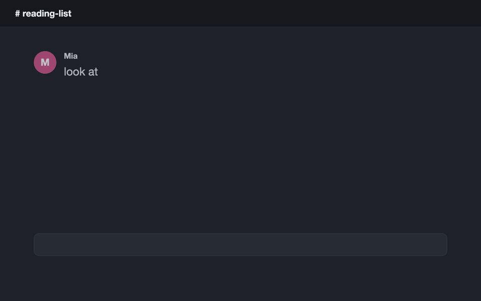

<div align="center">

<picture>
  <source media="(prefers-color-scheme: dark)" srcset="assets/banner-en-dark.svg">
  
</picture>

**English** · [繁體中文](README.zh-TW.md)

**[▶ Try the demo](https://kevinchu1110.github.io/driftnet/demo/)** · **[Website](https://kevinchu1110.github.io/driftnet/)** · **[Chrome extension](https://chromewebstore.google.com/detail/driftnet/inmlinbodfopmanbllkkjcgheelacddm)** · **[Docs](#-docs)**

[](https://www.npmjs.com/package/driftnet)
[](https://chromewebstore.google.com/detail/driftnet/inmlinbodfopmanbllkkjcgheelacddm)
[](https://glama.ai/mcp/servers/KevinChu1110/driftnet)
[](https://mcpservers.org/servers/kevinchu1110/driftnet)
[](LICENSE)

</div>

<p align="center"></p>

## 📖 What it is

Every day your feed carries great articles, open-source repos and tools past you. You paste them
into a chat "for later", and like everything else in the current, they drift out of sight.

**driftnet is the net you leave in that current.** Drop links in a group chat (LINE, Slack, Discord,
Telegram), click the Chrome button, import your old bookmarks or use the command line. driftnet
catches each one, follows a post to the project it is really about, boils it down to a short summary
in your language, and files it in your own folders, in a local catalogue with full-text search
(Chinese included). Your agents haul in the same catalogue over MCP. It runs on your own computer
and works with any model, or none.

## 🎥 See it work

**1. A post becomes the tool.** A Facebook reel with no links in it goes into the chat. driftnet reads the caption, finds both repos on GitHub by exact name, and files each as its own card. The chat gets one line; the summary is on the page.

```text
you ▸ this week's AI roundup https://www.facebook.com/share/v/1DfVB2odi3/

bot ▸ 📌 This week in AI (3/11)｜News ＋ Paperclip, RealWonder
      https://driftnet.example/#item-1
```

<p align="center"></p>
<sub>From a real run. The post had no links: driftnet read the caption and found both repos on GitHub by name.</sub>

**2. Know what it is at a glance.** Before: a bare link in a chat. After: a card with pictures from the page, a one-line answer, **what you'll see** and **why it's here**, so you can tell in seconds whether to open it.

<p align="center"></p>

**3. Sort with the mind map.** New links the AI filed on its own wait in the Inbox with two or three suggested folders. Or drag a card onto a folder on the mind map, which branches out from the root like XMind.

<p align="center"></p>

## ✨ Core features

### Catch the link

- 🎯 **Finds the actual tool.** A post linking a repo becomes the repo; a post that only *names* projects gets them looked up on GitHub by exact name. Links a model makes up are thrown away.
- 💬 **Reads "link in the comments".** The [Chrome extension](docs/chrome-extension.md) opens the comments; a weekly roundup becomes one item per project.
- 📥 **Many ways in.** A Chrome button, Discord, Telegram, Slack or LINE bots, your agent, or one HTTP call ([Ways in](docs/ways-in.md)).

### Understand and sort it

- 🖼️ **Cards you can read at a glance.** Pictures, a one-line answer, what you'll see, why it's here.
- 🗂️ **Your folders are the categories.** The AI files new links by each folder's path and description; its suggestions wait in the Inbox.
- 🧠 **Mind map and split view.** Drag cards onto folders; ✨ AI tidy-up proposes a plan that changes nothing until you apply it ([the web page](docs/web-page.md)).
- 📱 **A page you can search, on a phone too.** Notes, undo and trash, keyboard shortcuts, read-only share links.
- 🚫 **Not a read-later app.** Pocket and Raindrop keep the link you gave them. driftnet follows the post to the tool it is about, keeps a short outline instead of the whole page, and lets your agents read and write the same catalogue over MCP.

### Cheap, safe and yours

- 💸 **Spends almost nothing.** Repeat links are free and pages are cut to an outline of about 350 tokens before any model sees them. Five real Facebook reels were judged for $0.00029 in total.
- ⚖️ **Optional judge.** [Jev](https://console.typesafe.ai) (needs a TypeSafe key) decides in ~100 ms what is worth summarising. Without it, your model sorts each link.
- 🗳️ **Learns what to ignore.** 👎 a result and its publisher loses reputation; sources that keep getting voted down stop costing anything.
- 🛡️ **Safe by default.** Private and local addresses are refused, and prompt injection is never passed on to agents.
- 🤖 **Agents use it too.** MCP, `/openapi.json`, `/llms.txt`, `/feed.xml` and an outgoing webhook; or let them do the reading ([Agents](docs/agents.md)).
- 🧩 **Any model or none, and it stays yours.** A free local model through Ollama, a Claude or Gemini subscription you already have, a paid API key (pennies), or no model (links are then saved and wait unsorted under "Other"). Local SQLite; English and Traditional Chinese throughout.

## 🚀 Quick start

Everything runs on your own computer: no server to rent, no account. Want a look first?
**[Try the demo](https://kevinchu1110.github.io/driftnet/demo/)** runs the real page in your browser.

### Easiest: let your AI agent install it

Copy this into Claude Code, Cursor, Codex or any agent that can run commands on your computer:

```text
Read https://raw.githubusercontent.com/KevinChu1110/driftnet/main/docs/llms-install.txt and set up driftnet for me.
```

It checks Node.js, starts driftnet, connects itself over MCP and tells you when it is done.

### Or run one command yourself

You need [Node.js](https://nodejs.org) 22.13 or newer. Never used a terminal?
[Step by step for Mac and Windows](docs/install-beginners.md). Then, in a terminal:

```bash
npx driftnet
```

Your browser opens **http://localhost:8787**: that is driftnet's page, served by your own computer
(*localhost* means "this machine"; nobody else can see it). ⚙ Settings → AI: pick a provider and fill
in its key and model. Or skip it: links are still saved and wait unsorted under "Other", and an AI agent
can write the summaries ([Agents](docs/agents.md)). To connect the AI apps on this computer (Claude Code,
Claude Desktop, Cursor, Windsurf, Codex) in one go: `npx driftnet init`.

**Keep that terminal window open while you use driftnet: closing it stops driftnet.** To have it start
at login instead, run it from source and use `pnpm service:install` (macOS and Linux, see *Other ways to
run it* below); `npx driftnet` has no start-at-login option yet.

Your settings live in `~/.driftnet/.env` and the catalogue in `~/.driftnet/driftnet.db`.

### Add your first link

Any of these works:

- **On the page:** paste a link into the box and press Add.
- **In a terminal:** `npx driftnet add https://github.com/paperclipai/paperclip`
- **From the browser:** the [Chrome extension](https://chromewebstore.google.com/detail/driftnet/inmlinbodfopmanbllkkjcgheelacddm) sends the page you are looking at.
- **From a chat:** connect a [Discord, Telegram, Slack or LINE bot](docs/ways-in.md) and drop links there.

A card shows up within 5–30 seconds: what it is, why it might matter to you, and where it was filed.

<details>
<summary><b>Other ways to run it: from source, Docker</b></summary>

From source, to hack on it or run it as a login service:

```bash
git clone https://github.com/KevinChu1110/driftnet && cd driftnet
pnpm install
pnpm start                                                 # http://localhost:8787
pnpm service:install                                       # optional: start at login (macOS / Linux)
```

With Docker:

```bash
docker build -t driftnet https://github.com/KevinChu1110/driftnet.git
docker run -d -p 127.0.0.1:8787:8787 -v driftnet:/data -e DRIFTNET_HOST=0.0.0.0 driftnet start
```

Without `start`, the container is the MCP server over stdio (`docker run -i --rm -v driftnet:/data driftnet`).
`DRIFTNET_HOME` moves the settings and the catalogue somewhere else.

</details>

<details>
<summary><b>Not working?</b></summary>

- **Port 8787 is in use**: another driftnet is probably running; open http://localhost:8787, or start this one with `PORT=8788`.
- **`driftnet needs Node 22.13 or newer`**: install it with `nvm install 22` or from [nodejs.org](https://nodejs.org).
- **Cards stay ⏳ with no summary**: no model is set up yet. Choose one in ⚙ Settings → AI, or let your agent work the queue ([Agents](docs/agents.md)).
- **Opened from another computer and got `421`**: without a password driftnet only answers on this machine. Set a password (`DRIFTNET_TOKEN`), or list the address in `DRIFTNET_ALLOWED_HOSTS`.

</details>

### Which setup is yours?

| You are | Start with | Model |
|---|---|---|
| Just me, on my computer | The [Chrome extension](docs/chrome-extension.md) and [the web page](docs/web-page.md) | A local one through Ollama (see [Models](docs/models.md)), or none |
| A group chat | A Discord, Telegram, Slack or LINE bot, see [Ways in](docs/ways-in.md) | Any |
| My agents | [MCP, the Claude Code plugin or the agent queue](docs/agents.md) | None needed: the agent does the reading |


## 📚 Docs

| | |
|---|---|
| [Install for beginners](docs/install-beginners.md) | Never used a terminal: Mac and Windows, step by step |
| [How driftnet handles a link](docs/how-it-works.md) | The eight steps, reels and shorts, link health, search by meaning |
| [Ways in](docs/ways-in.md) | Chrome, Discord, Telegram, Slack, LINE, votes, the weekly digest |
| [The web page](docs/web-page.md) | Cards, folders, mind map, AI tidy-up, notes, sharing, shortcuts |
| [Chrome extension](docs/chrome-extension.md) | What it captures on Threads, X and Instagram, install |
| [Models](docs/models.md) | Picking a model (API, subscription, Ollama or none), judges, plugins |
| [Agents](docs/agents.md) | MCP tools, the Claude Code plugin, letting your agent do the reading |
| [Command line](docs/cli.md) | `driftnet add`, `search`, `export`, `backup` and the rest |
| [Settings](docs/settings.md) | Every setting, backup and restore |
| [Putting it online](docs/online.md) | A password, a public URL, LINE webhooks |
| [Contributing](CONTRIBUTING.md) | Layout, tests, releasing, extending |

## Where your data goes

> [!IMPORTANT]
> The catalogue stays on your machine. To judge and summarise a link, driftnet sends a **digest**
> (title, outline, the chat text it was shared with) to **TypeSafe** if Jev is on and to **your
> model provider** if one is set. Chat messages without a link are never processed or stored. With
> Ollama and `DRIFTNET_JUDGE=off`, nothing leaves your machine. Take it all with you any time: export
> to Markdown or an Obsidian / Notion vault from the sidebar, or `GET /api/export`. If you turn it on
> (`DRIFTNET_UPDATE_CHECK=1`), the only other call driftnet makes on its own is the once-a-day check for
> a new version (a plain request to the npm registry); it is off unless turned on.

### Backup and restore

**⚙ Settings › General › Backup** downloads one zip of your catalogue and settings (passwords and keys left out unless you ask); `npx driftnet backup` does the same from a terminal. See [Settings](docs/settings.md#backup-and-restore).

## Contributing

Issues with a link driftnet handled badly are the most useful help: real links people share are how every feature here was found. Code: see [CONTRIBUTING.md](CONTRIBUTING.md).

## Support

driftnet is free and MIT. If it saves you time, a star helps others find it, and you can
[buy me a coffee](https://buymeacoffee.com/guanrung11n).

<a href="https://buymeacoffee.com/guanrung11n"></a>

## License

[MIT](LICENSE)
