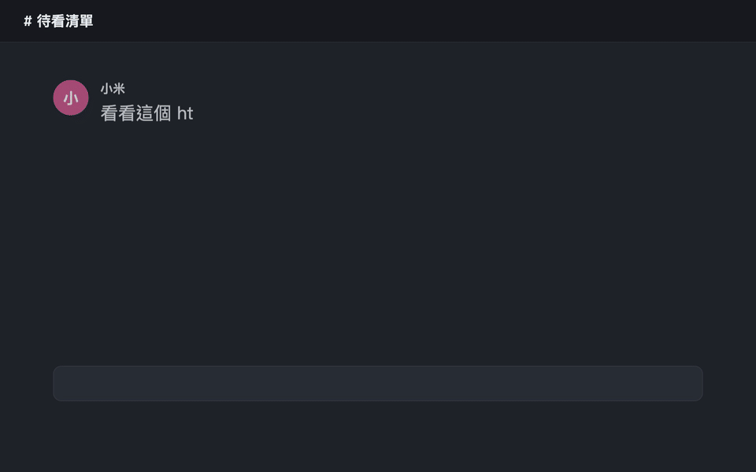
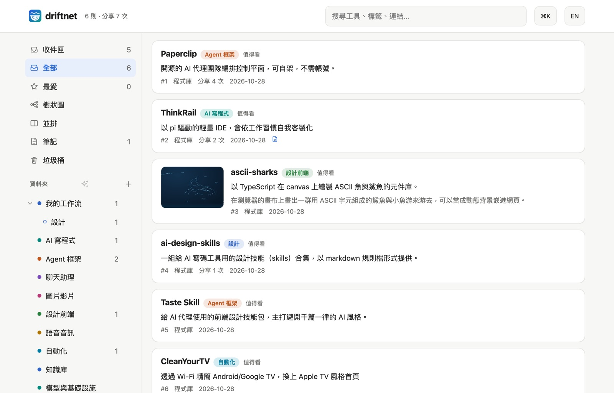
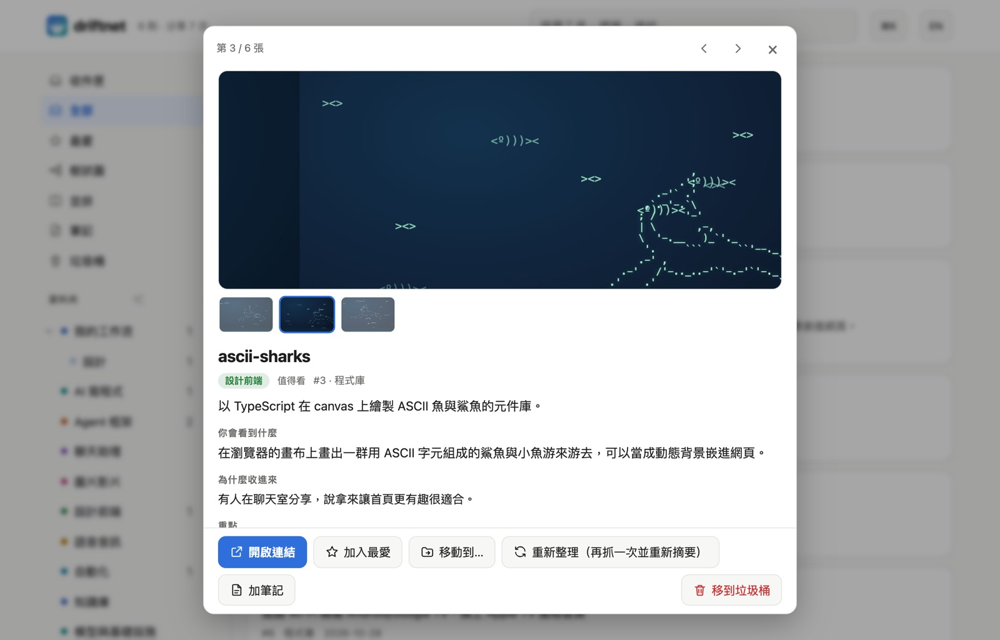

<div align="center">

<picture>
  <source media="(prefers-color-scheme: dark)" srcset="assets/banner-zh-TW-dark.svg">
  
</picture>

[English](README.md) · **繁體中文**

**[▶ 線上試玩](https://kevinchu1110.github.io/driftnet/demo/)** · **[官方網站](https://kevinchu1110.github.io/driftnet/)** · **[Chrome 擴充](https://chromewebstore.google.com/detail/driftnet/inmlinbodfopmanbllkkjcgheelacddm)** · **[文件](#-文件)**

[](https://www.npmjs.com/package/driftnet)
[](https://chromewebstore.google.com/detail/driftnet/inmlinbodfopmanbllkkjcgheelacddm)
[](https://glama.ai/mcp/servers/KevinChu1110/driftnet)
[](https://mcpservers.org/servers/kevinchu1110/driftnet)
[](LICENSE)

</div>

<p align="center"></p>

## 📖 這是什麼

每天，社群動態像浪潮一樣捲過無數好文章、開源專案和好工具。你隨手貼進聊天室說「之後再看」，
結果它們跟著浪潮漂走，再也沒看過。

**driftnet 是你放進這片資訊海裡的漂流網。** 丟進群組（LINE、Slack、Discord、Telegram）、按一下 Chrome 擴充、
匯入舊書籤，或用指令列都可以。driftnet 攔下每個漂過的連結，追到貼文真正介紹的專案本體，濾掉雜訊、用你的語言寫成精簡摘要，
歸進你自己的資料夾，放進支援中文全文搜尋的本機知識庫。你的 AI agent 也能透過 MCP 隨時來收網。
它跑在你自己的電腦上，可以接任何模型，也可以完全不接。

## 🎥 實際看看

**1. 貼文變成工具。** 一則沒有附任何連結的 Facebook reel 丟進聊天室。driftnet 讀了說明文字，用名稱到 GitHub 找到兩個 repo，各收成一張卡片。聊天室只回一行，整理好的摘要在網頁上。

```text
你  ▸ 這週的 AI 整理 https://www.facebook.com/share/v/1DfVB2odi3/

bot ▸ 📌 本週 AI 大事彙整（3/11）｜新聞動態 ＋ Paperclip、RealWonder
      https://driftnet.example/#item-1
```

<p align="center"></p>
<sub>實測結果。這篇貼文沒有附任何連結，driftnet 讀了說明文字，再用名稱到 GitHub 找到兩個 repo。</sub>

**2. 一眼看懂它是什麼。** 之前：聊天室裡一條光禿禿的連結。之後：一張卡片，有網頁上的圖片、一句話的答案、**你會看到什麼**和**為什麼會在這裡**，幾秒就能判斷要不要點開。

<p align="center"></p>

**3. 用樹狀圖整理。** AI 自己分好的新連結會放在收件匣，附兩、三個建議資料夾。也可以在樹狀圖上把卡片拖到資料夾，樹狀圖像 XMind 一樣從中心往外展開。

<p align="center"></p>

## ✨ 核心功能

### 接住連結

- 🎯 **追到真正的工具。** 貼文附了 repo，就收錄 repo；貼文只提到專案名稱，就到 GitHub 用名稱完全比對。模型編出來的連結一律丟掉。
- 💬 **看得懂「連結在留言」。** [Chrome 擴充](docs/zh-TW/chrome-extension.md)會打開留言找；一篇週報整理文，會拆成每個專案各一筆。
- 📥 **很多種丟法。** Chrome 按鈕、Discord、Telegram、Slack 或 LINE 機器人、你的 agent，或一個 HTTP 請求（見[接法](docs/zh-TW/ways-in.md)）。

### 看懂、整理

- 🖼️ **一眼看懂的卡片。** 圖片、一句話的答案、你會看到什麼、為什麼會在這裡。
- 🗂️ **資料夾就是分類。** AI 照每個資料夾的路徑和說明分新連結，建議放在收件匣等你確認。
- 🧠 **樹狀圖和並排檢視。** 把卡片拖到資料夾；✨ AI 整理建議會提一份方案，你套用之前什麼都不會動（見[網頁](docs/zh-TW/web-page.md)）。
- 📱 **可以搜尋的網頁，手機也能用。** 筆記、復原和垃圾桶、鍵盤快捷鍵、唯讀分享連結。
- 🚫 **不是稍後閱讀 App。** Pocket、Raindrop 存的是你給它的那個連結；driftnet 會順著貼文追到它在講的工具，只留一份簡短大綱而不是整頁內容，你的 agent 還能透過 MCP 讀寫同一份清單。

### 便宜、安全、資料是你的

- 💸 **幾乎不花錢。** 重複的連結不再處理；頁面先整理成約 350 token 的大綱才給模型看。實測 5 個 FB reels，判斷全部只花 $0.00029。
- ⚖️ **選用的判斷器。** [Jev](https://console.typesafe.ai)（需要 TypeSafe 金鑰）用約 100ms 決定哪些值得摘要。沒有 Jev 時，由你選的模型逐筆分類。
- 🗳️ **學會排除垃圾。** 按 👎，發布者的信譽就下降；一直被倒讚的來源之後就不再花錢處理。
- 🛡️ **預設就安全。** 拒絕指向私有或本機位址的連結，提示詞注入永遠不會傳給 agent。
- 🤖 **agent 也能用。** MCP、`/openapi.json`、`/llms.txt`、`/feed.xml` 和對外 Webhook；也可以讓它們自己來讀（見 [Agent](docs/zh-TW/agents.md)）。
- 🧩 **模型任選或不接，資料屬於你。** API、你的 Claude 或 Google 訂閱、Ollama，或完全不接（連結就全部放在「other」，不分類）。資料存在本機 SQLite；介面、回覆和摘要都支援英文與繁體中文。

## 🚀 開始使用

全部跑在你自己的電腦上：不用租伺服器，也不用註冊帳號。想先看看？
**[線上試玩](https://kevinchu1110.github.io/driftnet/demo/)** 直接在瀏覽器跑真正的網頁。

### 最簡單：交給你的 AI agent 安裝

把下面這句複製給 Claude Code、Cursor、Codex，或任何能在你電腦上執行指令的 agent：

```text
Read https://raw.githubusercontent.com/KevinChu1110/driftnet/main/docs/llms-install.txt and set up driftnet for me.
```

它會檢查 Node.js、啟動 driftnet、透過 MCP 把自己接上，完成後告訴你。

### 或自己跑一行指令

需要 [Node.js](https://nodejs.org) 22.13 以上。在終端機輸入：

```bash
npx driftnet
```

瀏覽器會自動打開 **http://localhost:8787**：這是你自己電腦提供的 driftnet 網頁
（*localhost* 就是「這台電腦」，別人看不到）。⚙ 設定會帶你選模型，也可以先跳過、不接模型直接用。
想一次接好這台電腦上的 AI 工具（Claude Code、Claude Desktop、Cursor、Windsurf、Codex）：`npx driftnet init`。

設定存在 `~/.driftnet/.env`，清單存在 `~/.driftnet/driftnet.db`。

### 加入第一個連結

任選一種：

- **在網頁上：** 把連結貼進輸入框，按「收錄」。
- **在終端機：** `npx driftnet add https://github.com/paperclipai/paperclip`
- **在瀏覽器：** [Chrome 擴充](https://chromewebstore.google.com/detail/driftnet/inmlinbodfopmanbllkkjcgheelacddm)會送出你正在看的頁面。
- **在聊天室：** 接上 [Discord、Telegram、Slack 或 LINE 機器人](docs/zh-TW/ways-in.md)，直接把連結丟進去。

5～30 秒內就會出現一張卡片：它是什麼、為什麼值得你看、放進了哪個資料夾。

<details>
<summary><b>其他跑法：從原始碼、Docker</b></summary>

從原始碼跑，想改程式或設成開機自動執行：

```bash
git clone https://github.com/KevinChu1110/driftnet && cd driftnet
pnpm install
pnpm start                                                 # http://localhost:8787
pnpm service:install                                       # 選用：登入後自動執行（macOS／Linux）
```

用 Docker：

```bash
docker build -t driftnet https://github.com/KevinChu1110/driftnet.git
docker run -d -p 127.0.0.1:8787:8787 -v driftnet:/data -e DRIFTNET_HOST=0.0.0.0 driftnet start
```

不加 `start` 時，容器就是 stdio 的 MCP 伺服器（`docker run -i --rm -v driftnet:/data driftnet`）。
用 `DRIFTNET_HOME` 可以把設定和清單一起搬到別的地方。

</details>

<details>
<summary><b>沒反應？</b></summary>

- **8787 埠被占用**：多半是已經有一個 driftnet 在跑；直接開 http://localhost:8787，或用 `PORT=8788` 啟動這一個。
- **`driftnet needs Node 22.13 or newer`**：用 `nvm install 22` 或從 [nodejs.org](https://nodejs.org) 安裝。
- **卡片一直是 ⏳、沒有摘要**：還沒設定模型。到 ⚙ 設定 → AI 選一個，或交給你的 agent 整理佇列（見 [Agent](docs/zh-TW/agents.md)）。
- **從別台電腦打開得到 `421`**：沒設密碼時 driftnet 只回應本機。設一組密碼（`DRIFTNET_TOKEN`），或把網址加進 `DRIFTNET_ALLOWED_HOSTS`。

</details>

### 哪種用法適合你

| 你是 | 從這裡開始 | 模型 |
|---|---|---|
| 只有我自己，用我的電腦 | [Chrome 擴充](docs/zh-TW/chrome-extension.md)加[網頁](docs/zh-TW/web-page.md) | 用 Ollama 跑本機模型（見[模型](docs/zh-TW/models.md)），或不接 |
| 一個群組聊天室 | Discord、Telegram、Slack 或 LINE 機器人，見[接法](docs/zh-TW/ways-in.md) | 任選 |
| 我的 agent | [MCP、Claude Code 外掛或 agent 佇列](docs/zh-TW/agents.md) | 不用接：由 agent 自己讀 |


## 📚 文件

| | |
|---|---|
| [driftnet 怎麼處理一個連結](docs/zh-TW/how-it-works.md) | 八個步驟、短影音、連結健康檢查、以語意搜尋 |
| [接法](docs/zh-TW/ways-in.md) | Chrome、Discord、Telegram、Slack、LINE、投票、每週摘要 |
| [網頁](docs/zh-TW/web-page.md) | 卡片、資料夾、心智圖、AI 整理、筆記、分享、快捷鍵 |
| [Chrome 擴充](docs/zh-TW/chrome-extension.md) | 在 Threads、X、Instagram 擷取什麼、安裝 |
| [模型](docs/zh-TW/models.md) | 選模型（API、訂閱、Ollama 或不接）、判斷器、外掛 |
| [Agent](docs/zh-TW/agents.md) | MCP 工具、Claude Code 外掛、讓 agent 幫你讀 |
| [指令列](docs/zh-TW/cli.md) | `driftnet add`、`search`、`export`、`backup` 等 |
| [設定](docs/zh-TW/settings.md) | 所有設定、備份與還原 |
| [放上網路](docs/zh-TW/online.md) | 密碼、公開網址、LINE webhook |
| [參與開發](CONTRIBUTING.zh-TW.md) | 目錄結構、測試、發版、擴充 |

## 資料去哪裡

> [!IMPORTANT]
> 清單留在你的電腦上。判斷和摘要時，driftnet 會把連結的**摘錄**（標題、大綱、分享時附的聊天文字）送到
> **TypeSafe**（有開 Jev 時）和**你設定的模型供應商**。沒有連結的聊天訊息不會被處理或儲存。
> 用 Ollama 並設 `DRIFTNET_JUDGE=off`，就完全不會有資料離開你的電腦。隨時都能整包帶走：側邊欄可以匯出成
> Markdown 或 Obsidian／Notion 的 vault，也可以用 `GET /api/export`。若你開啟（`DRIFTNET_UPDATE_CHECK=1`），driftnet 自己主動發出的另一個請求，
> 只有每天一次的新版本檢查（對 npm registry 的單純請求）；預設是關閉的。

### 備份與還原

**⚙ 設定 › 一般 › 備份** 會把卡片和設定打包成一個 zip（密碼和金鑰預設不含）；終端機用 `npx driftnet backup` 也一樣。詳見[設定](docs/zh-TW/settings.md#備份與還原)。

## 參與開發

最有幫助的是開 issue 附上 driftnet 處理得不好的連結：這裡的每個功能都是從大家實際分享的連結找出來的。程式碼請見 [CONTRIBUTING.zh-TW.md](CONTRIBUTING.zh-TW.md)。

## 支持

driftnet 免費、MIT 授權。如果它幫你省了時間，按個星星能讓更多人找到它，也可以
[請我喝杯咖啡](https://buymeacoffee.com/guanrung11n)。

<a href="https://buymeacoffee.com/guanrung11n"></a>

## 授權

[MIT](LICENSE)
